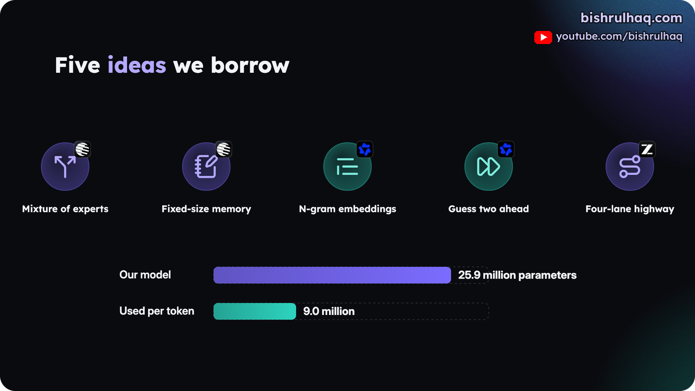
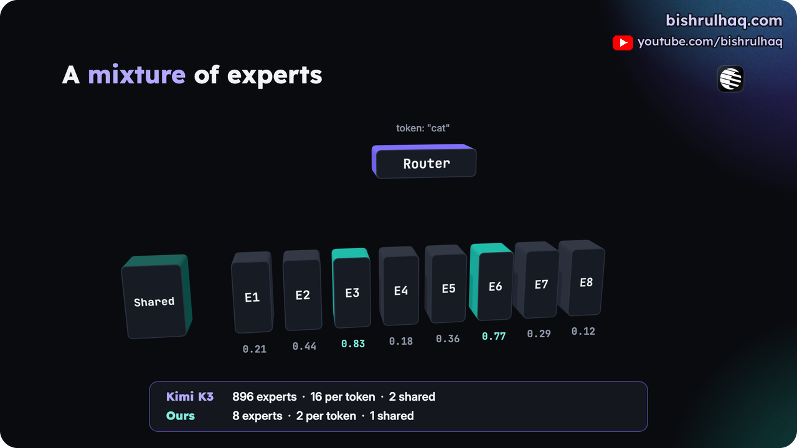
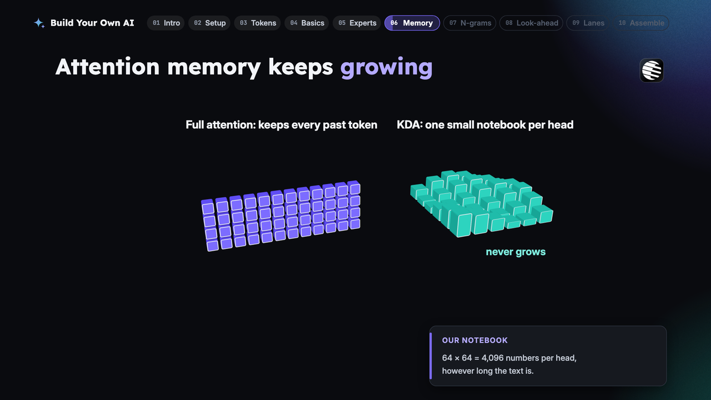
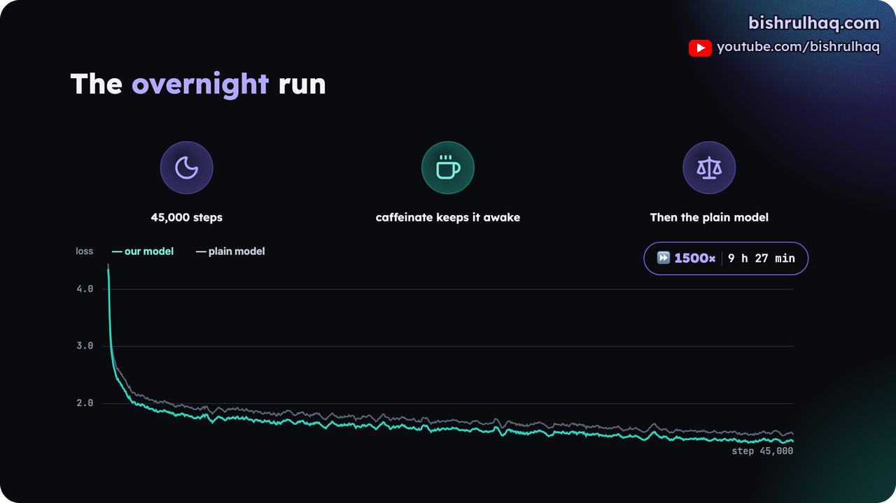
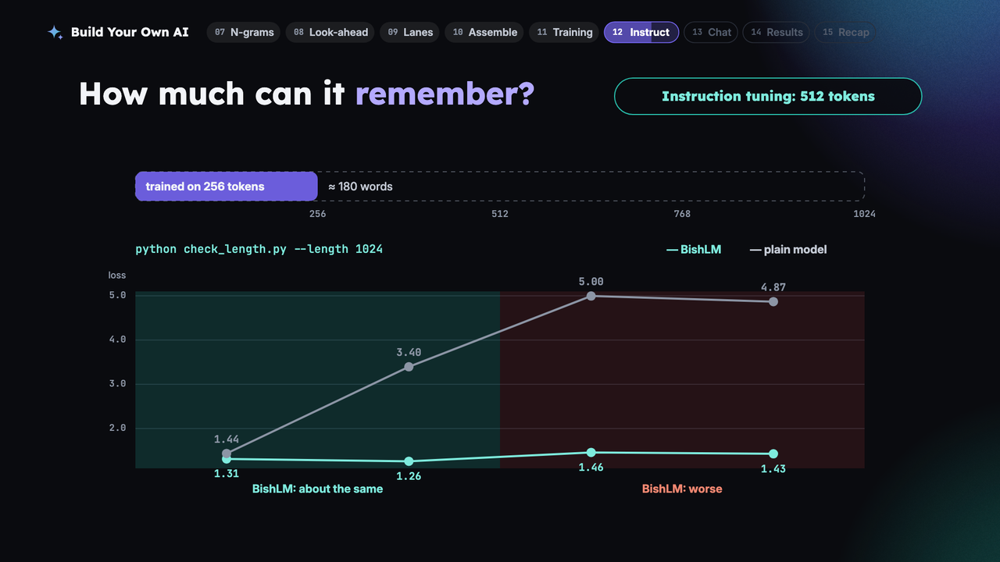
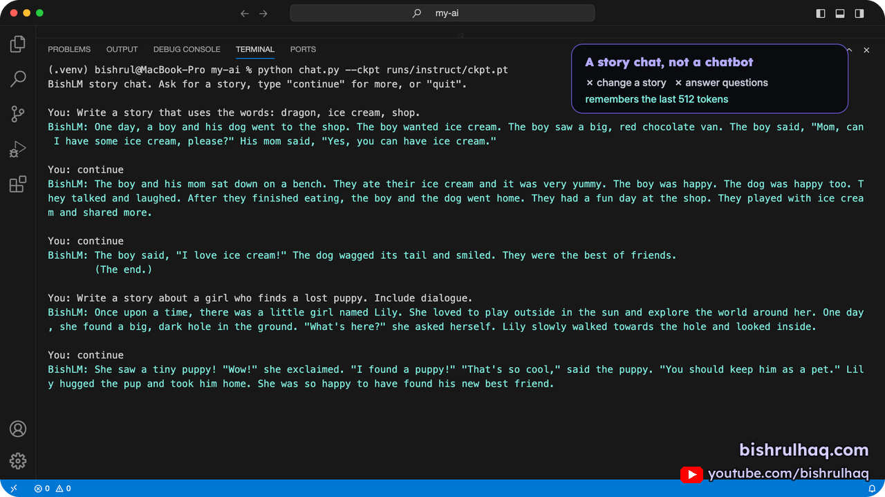
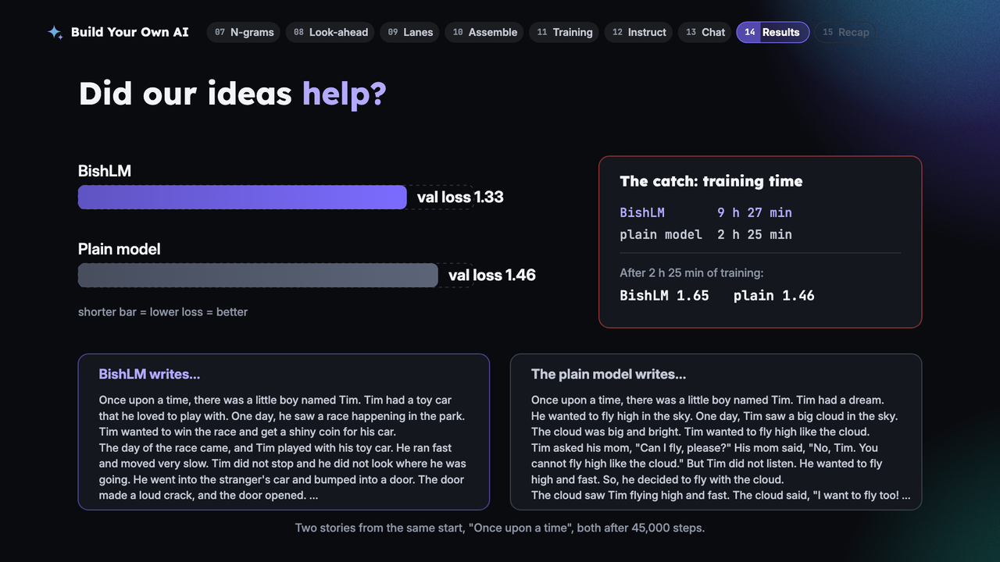
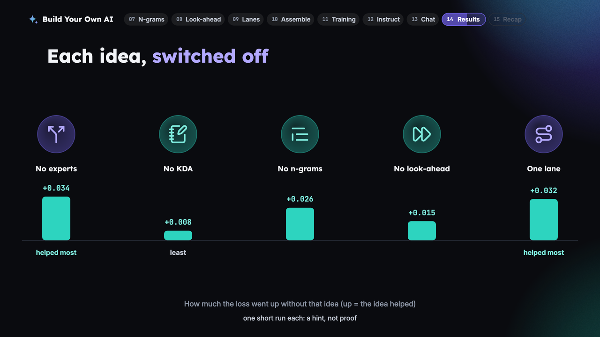
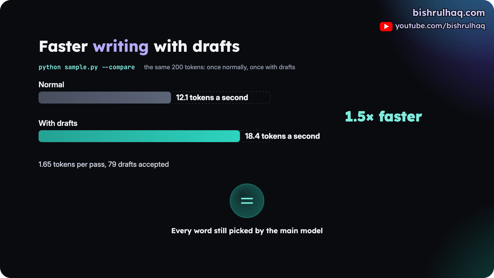

# BishLM


**Step-by-step article:** [Build Your Own AI at Home](https://bishrulhaq.com/posts/build-your-own-ai-at-home) walks through every part, the training and the results.

A small language model, built from scratch in PyTorch and trained on a MacBook. It uses five ideas from three of 2026's best open models:

| Idea | Borrowed from | What it does | Code |
|---|---|---|---|
| Mixture of experts | Kimi K3 | Many small feed-forward "experts". A router sends each token to only 2 of them, plus 1 shared expert. | [bishlm/moe.py](bishlm/moe.py) |
| Linear attention, 3:1 | Kimi K3 | 3 of every 4 layers use Kimi Delta Attention, which keeps a fixed-size memory instead of a growing one | [bishlm/kda.py](bishlm/kda.py) |
| N-gram embeddings | Qwen3.8-Flash-Next | Hashed vectors for the last 2 and 3 tokens, added at layer 2 | [bishlm/ngram.py](bishlm/ngram.py) |
| Multi-token prediction | Qwen3.8-Flash-Next | An extra head that guesses the token after next, used for faster writing | [bishlm/model.py](bishlm/model.py), [bishlm/generate.py](bishlm/generate.py) |
| mHC hyper-connections | GLM-5.3-Flash | The residual stream widened to 4 lanes, mixed by a doubly stochastic matrix | [bishlm/mhc.py](bishlm/mhc.py) |

BishLM is **inspired by** these models. It uses none of their code or weights. [docs/sources.md](docs/sources.md) lists what each real model does, with links to the primary sources, and what BishLM simplifies.

Every idea has an on/off switch in [bishlm/config.py](bishlm/config.py), so you can train with and without it and compare.



<p>
  
  
</p>

## Setup

You need Python 3.10 or newer. A Mac with Apple Silicon (M1 or newer) uses its GPU. An NVIDIA GPU or a plain CPU works too.

```bash
git clone https://github.com/bishrulhaq/BishLM.git
cd BishLM
python3 -m venv .venv
source .venv/bin/activate
pip install -r requirements.txt
```

## Try it without training

Download the trained model (about 99 MB) and chat with it:

```bash
python download_model.py
python chat.py --ckpt models/instruct.pt
python sample.py --ckpt models/bishlm.pt --prompt "Once upon a time"
```

`models/bishlm.pt` is the base model after 45,000 steps, and `models/instruct.pt` the instruction-tuned one. Both are weights only, stored as 16-bit floats (see [export_model.py](export_model.py)), with the same validation loss as the full training checkpoints. To run instruction tuning yourself, start from the download with `--init models/bishlm.pt`.

## 1. Prepare the data

```bash
python prepare_data.py
```

This downloads [TinyStories](https://huggingface.co/datasets/roneneldan/TinyStories) (about 2.2 GB, 2.7 million short stories). It then trains a 4,096-token BPE tokenizer and turns every story into token ids. The result is `data/train.bin` with about 553 million tokens. On an M1 Pro this takes about a minute after the download.

## 2. Train

```bash
python train.py --preset small --minutes 10 --out runs/first     # a quick first run
python train.py --preset bishlm --steps 45000 --out runs/bishlm  # the full model (overnight)
python train.py --preset plain  --steps 45000 --out runs/plain   # a plain transformer, to compare
```

The script prints the loss and a sample story as it trains. It saves `ckpt.pt` and `log.jsonl` in the output folder.



To see what one idea changes, use the presets that switch a single idea off: `small-no-moe`, `small-no-linear`, `small-no-ngram`, `small-no-mtp` and `small-no-mhc`.

## 3. Let it write

```bash
python sample.py --ckpt runs/bishlm/ckpt.pt --prompt "Once upon a time"
python sample.py --ckpt runs/bishlm/ckpt.pt --compare   # normal vs speculative decoding speed
```

## 4. Teach it to follow a request (instruction tuning)

The base model only continues text. A second, short round of training on
TinyStories-Instruct teaches it to write the story you ask for:

```bash
python prepare_instruct.py --max-mb 300
python train.py --preset bishlm --init runs/bishlm/ckpt.pt --data instruct --seq-len 512 --batch 8 \
    --no-compile --steps 2000 --lr 3e-4 --warmup 50 --out runs/instruct
python sample.py --ckpt runs/instruct/ckpt.pt --instruct "Write a story that uses the words: dragon, ice cream, shop."
```

Only the story is graded, not the request (see `bishlm/instruct.py`). One row in five is a plain
story, so the model keeps its old skill.

`--seq-len 512` doubles the window. BishLM was trained on 256 tokens, but its KDA layers and
NoPE attention do not depend on positions, so it already reads 512 tokens well. Check it with
`python check_length.py --ckpt runs/bishlm/ckpt.pt --length 1024`. (At 512 tokens,
`torch.compile` makes a kernel too big for Apple GPUs, so this run uses `--no-compile`.)



## 5. Chat with it

```bash
python chat.py --ckpt runs/instruct/ckpt.pt
```

Ask for a story, type `continue` for more of it, or `quit`. It is a story chat, not a chatbot:
it cannot change a story or answer questions about it, because it never saw examples of that.
It only remembers its last 512 tokens.



## Results

All numbers come from the runs in the video, on an M1 Pro with 16 GB.

- **Quality.** After the same 45,000 steps (184 million tokens), BishLM reaches a validation loss of 1.33 and the plain model 1.46. Lower is better.
- **The catch.** BishLM is bigger and slower: it trained for 9 h 27 min, the plain model for 2 h 25 min. After 2 h 25 min BishLM was still at 1.65, so for the same training time the plain model wins at this tiny size.
- **Each idea.** Six small runs of 2,000 steps, each with one idea switched off. Every idea helped a little. Without it, the loss went up by: experts +0.034, four lanes +0.032, n-grams +0.026, look-ahead +0.015, KDA +0.008. That is one run each, so take it as a hint, not proof.
- **Writing with drafts.** Speculative decoding with the MTP head goes from 12.1 to 18.4 tokens a second (1.5×), with 1.65 tokens per pass. Every token is still sampled from the main model, so the quality is the same. With temperature 0 the text is identical.
- **Instruction tuning.** 2,000 steps at 512 tokens took 37 minutes (validation loss 1.27). In the words test it used "ice cream" and "shop", but forgot "dragon".







## Tests

```bash
python -m pytest -q
```

Each test checks one claim. For example: the fast chunked linear attention gives the same result as the slow token-by-token loop; the model cannot see future tokens; with randomness off (temperature 0), speculative decoding writes exactly the same text as normal decoding; Sinkhorn makes every row and column sum to 1.

## Speed on an M1 Pro (16 GB)

Training speed, from `python bench.py --compile`, with batch 16 and 256 tokens:

| Preset | Parameters (total / active per token) | Tokens per second |
|---|---|---|
| bishlm | 25.9M / 9.0M | ~7,900 |
| plain | 7.0M / 7.0M | ~22,800 |

The plain model is faster on a laptop. BishLM's ideas were designed for very large models, long texts and big GPU clusters: fewer FLOPs per token at huge scale and a memory that does not grow with the text. At this tiny size, the extra small GPU kernels cost more than they save. The video shows both the speed and the quality, honestly.

## Project layout

```
bishlm/
  config.py     all settings and the on/off switches
  tokenizer.py  byte-level BPE, from scratch
  layers.py     RMSNorm, SwiGLU, RoPE, attention
  kda.py        Kimi Delta Attention (slow loop + fast chunked version)
  moe.py        mixture of experts with aux-loss-free balancing
  ngram.py      hashed n-gram embeddings
  mhc.py        mHC hyper-connections + Sinkhorn-Knopp
  model.py      BishLM itself and the MTP head
  generate.py   normal and speculative decoding
  instruct.py   requests for instruction tuning
  chat.py       the story chat loop
prepare_data.py   step 1
train.py          step 2
sample.py         step 3
prepare_instruct.py, chat.py   steps 4 and 5
check_length.py   can it read more than 256 tokens?
bench.py          speed test
download_model.py the trained model, from bishrulhaq.com
export_model.py   a training checkpoint -> a small weights-only file
tests/            checks for every part
docs/             sources and notes
```

## Credits

- TinyStories and TinyStories-Instruct: Ronen Eldan and Yuanzhi Li, 2023, [arXiv 2305.07759](https://arxiv.org/abs/2305.07759). Licence: CDLA-Sharing-1.0.
- The ideas come from the Kimi K3 tech report, the Kimi Linear paper, the Qwen3.8-Next paper, the GLM-5.3-Flash model card and the mHC and Hyper-Connections papers. All links are in [docs/sources.md](docs/sources.md).

Code licence: MIT (see [LICENSE](LICENSE)).

Made by Bishrul Haq. [bishrulhaq.com](https://bishrulhaq.com) · [The full article](https://bishrulhaq.com/posts/build-your-own-ai-at-home)
